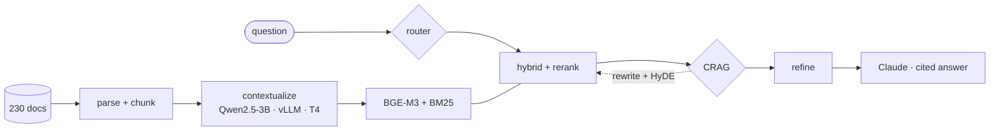

# DP_task_RAG: advanced + agentic RAG over Harvey LAB legal data rooms

RAG over the **`antitrust-competition`** practice area of [Harvey LAB](https://github.com/harveyai/harvey-labs/tree/main/tasks): 31 matters, 230 documents (docx/xlsx/eml/pptx), ~2.1M tokens.
- **Runs on a free Colab T4.** The GPU runs embeddings, reranking, CRAG strip scoring and the one-off contextualization LLM.
- **Uses Claude through `claude_agent_sdk`** for reasoning, with the subscription token kept in Colab Secrets. An Anthropic-API fallback is included.

| Notebook | What | Colab |
|---|---|---|
| `notebooks/02_demo_and_eval.ipynb` | build indexes, demo the agent, run the evaluation, Phoenix traces | [Open in Colab](https://colab.research.google.com/github/nrusnac/DP_task_RAG/blob/main/notebooks/02_demo_and_eval.ipynb) |
| `notebooks/01_contextualize_colab.ipynb` | one-off Contextual Retrieval job (Qwen2.5-3B on vLLM, ~80–90 min, output committed) | [Open in Colab](https://colab.research.google.com/github/nrusnac/DP_task_RAG/blob/main/notebooks/01_contextualize_colab.ipynb) |

## What's inside
**Advanced RAG techniques** ([docs/03](docs/03-rag-techniques.md)):
- structure-aware parsing (tracked changes, malformed XML) and chunking
- **Contextual Retrieval**, in a per-document variant that's 2.7× faster on a T4
- **hybrid BGE-M3 + BM25 with RRF**
- **cross-encoder reranking**
- data-room scoping
- query decomposition / rewriting / **HyDE**

**Agentic module** ([docs/04](docs/04-agentic-module.md)): a LangGraph controller for the **retrieval step**.
- **Adaptive-RAG** routes each query (direct / simple / complex).
- **CRAG** grades the evidence with reranker scores (Claude only when the score is ambiguous), refines it to relevant sentence strips, rewrites failing queries with keywords + HyDE, and **abstains** instead of guessing.
- A sufficiency loop fills gaps on complex queries.
- Every decision is logged and traced.

**Evaluation** ([docs/05](docs/05-evaluation.md)):
- a QA set derived from Harvey rubric criteria, with silver retrieval labels
- retrieval ablations
- CRAG threshold calibration
- naive vs. single-shot vs. agent, judged with **Harvey's own rubric prompt** plus faithfulness
- the Adaptive-RAG ablation

**Observability** ([docs/06](docs/06-observability.md)): Arize Phoenix in the notebook, with LangGraph auto-instrumented and manual retriever, reranker and LLM spans.



All design choices, with alternatives and measurements: [docs/07-decision-log.md](docs/07-decision-log.md). Dataset findings: [docs/01](docs/01-dataset.md). Architecture and the full node-by-node flow: [docs/02](docs/02-architecture.md).

## Results
<!-- RESULTS:START -->
*Filled in after the Colab evaluation run; see [docs/05-evaluation.md](docs/05-evaluation.md).*
<!-- RESULTS:END -->

## Quickstart
**Colab (recommended):**
1. Open `02_demo_and_eval.ipynb` and choose *Runtime → T4 GPU*.
2. Add the secret `CLAUDE_CODE_OAUTH_TOKEN` (run `claude setup-token` locally to get one) or `ANTHROPIC_API_KEY`.
3. *Run all.*

**Local:**
```bash
pip install -e ".[obs,dev]"
python -m hrag.ingest.build                      # A1-A3: download subset, parse, chunk  -> artifacts/
python -m hrag.index.build --variants raw header ctx   # A5 (needs artifacts/contexts.jsonl for ctx)
python -m hrag.eval.run_eval retrieval           # retrieval ablations (no LLM)
python -c "from hrag.agent.graph import answer_sync as a; print(a('What is the post-merger HHI for flame retardants in the South Central region?', task_id='analyze-iss-antitrust-transaction-structure')['answer'])"
pytest -q
```

**Credentials** are read from the environment or Colab Secrets and are never printed. With `CLAUDE_CODE_OAUTH_TOKEN` (or a local `claude` login) the Agent SDK uses your subscription. With only `ANTHROPIC_API_KEY`, the API backend is used. Bring your own: please don't share tokens.

## Repository
```
src/hrag/   config · llm · ingest/ · index/ · retrieve/ · agent/ · eval/ · obs/
scripts/    contextualize_vllm.py (standalone, resumable)
notebooks/  01_contextualize_colab · 02_demo_and_eval
artifacts/  chunks.parquet · tasks.jsonl · contexts.jsonl · eval/
docs/       01-dataset · 02-architecture · 03-rag-techniques · 04-agentic-module · 05-evaluation · 06-observability · 07-decision-log
prep/       colab_smoke_test.ipynb (pre-build de-risking: SDK, GPU models, vLLM, Phoenix on a T4)
```

Data: Harvey LAB, MIT License, © Harvey AI. `artifacts/` holds chunks derived from it.
