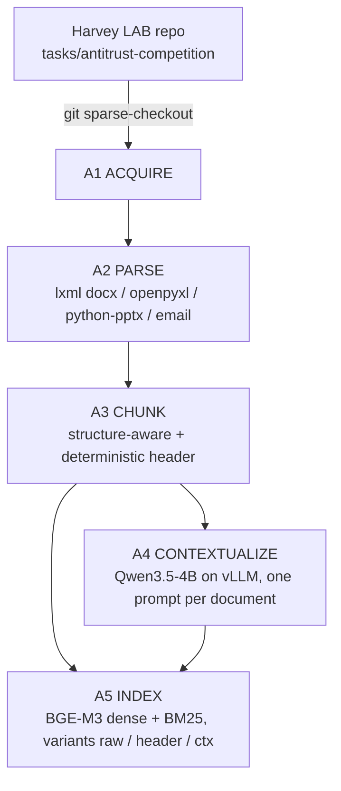
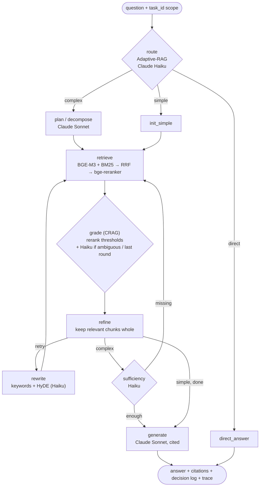

# 02 · Architecture and end-to-end workflow

## Offline indexing (run once; outputs cached in `artifacts/` and `data/index/`)



| Step | Input → Output | Model / tool | Where | Code |
|---|---|---|---|---|
| A1 Acquire | GitHub → 44 `task.json` + 318 files (antitrust area + `config.extra_tasks`) | `git sparse-checkout` | CPU, 5 s | `ingest/build.py` |
| A2 Parse | files → ordered elements (heading / para / table / slide / email) | `lxml` (recover, tracked changes), `openpyxl`, `python-pptx`, `email` | CPU | `ingest/parsers.py` |
| A3 Chunk | elements → 8,627 chunks ≤ ~600 tokens + `[doc] (type) › section` header | BGE-M3 tokenizer | CPU, 30 s total for A1–A3 | `ingest/chunking.py` |
| A4 Contextualize | each document with `[[ci]]` markers → `contexts.jsonl` | **Qwen3.5-4B** (fallback Qwen3-4B-Instruct-2507), vLLM fp16, own venv + subprocess | **T4**, ~2–2.5 h, once | `ingest/contextualize.py`, `scripts/contextualize_vllm.py`, `notebooks/01_contextualize_colab.ipynb` |
| A5 Index | header [+ context] + chunk → dense matrix + BM25 | **BGE-M3** fp16; `bm25s` + legal token pattern | **T4** ~1.5 min per variant | `index/build.py` |

## Online query pipeline: the agentic module (LangGraph)



| Node | Input → Output | Model | Why |
|---|---|---|---|
| `route` | question → direct / simple / complex | Claude Haiku (JSON schema, no thinking) | Adaptive-RAG: retrieval effort ∝ query complexity |
| `plan` | question (+ already-searched list) → 2–5 sub-questions | Claude Sonnet (JSON) | multi-part questions need one retrieval per part |
| `retrieve` | sub-question (+ HyDE) + `task_id` → top-8 reranked hits | BGE-M3 + BM25 → RRF(k=60) → bge-reranker-v2-m3 | hybrid recall, cross-encoder precision, data-room scoping |
| `grade` | rerank scores → correct / ambiguous / incorrect | thresholds; Haiku in the ambiguous band and before giving up in the last round | CRAG retrieval evaluator |
| `refine` | graded hits → kept whole chunks (all top-8 if correct, Haiku's picks if ambiguous) | – | CRAG knowledge refinement at chunk level: sentence strips lost the clause and table context answers need |
| `rewrite` | failed sub-question → BM25 keywords + HyDE passage (≤ 2 rounds) | Claude Haiku | CRAG corrective retrieval; abstain if still failing |
| `sufficiency` | evidence per sub-question → missing sub-questions (1 iteration) | Claude Haiku | multi-hop gap filling |
| `generate` | ≤ 8 chunks per sub-question (≤ 16) + insufficiency flags → cited answer | Claude Sonnet | grounded, checkable output |

All Claude calls go through `hrag.llm.complete()`:
- **Primary backend:** `claude_agent_sdk` with the subscription OAuth token from Colab Secrets. Tools are disabled, filesystem settings are isolated, and `ANTHROPIC_API_KEY` is blanked so it can't silently take precedence.
- **Fallback backend:** the Anthropic API with `ANTHROPIC_API_KEY`.
- Concurrency is capped (6) and calls are retried.

## Where each model runs
| Model | Where | When | VRAM |
|---|---|---|---|
| Qwen3.5-4B | T4, separate process | offline, once | vLLM reserves 85%; released on exit |
| BGE-M3 (568M) | T4 | indexing + every query (~60 ms) | ~1.8 GB |
| bge-reranker-v2-m3 (568M) | T4 | rerank (~0.75 s / 30 pairs) | ~1–3 GB |
| Claude Haiku / Sonnet | Anthropic via `claude_agent_sdk` | routing, grading, rewriting, planning, generation, judging | – |

## Repository layout
```
src/hrag/config.py         every knob (env-overridable HRAG_*), incl. the JAX-on-CPU fix
src/hrag/llm.py            Claude interface (Agent SDK + API fallback), stats, LLM spans
src/hrag/ingest/           acquire, parse, chunk, contextualize (prepare + loader)
src/hrag/index/            model loading (fp16 on CUDA), index build (dense + BM25, 3 variants)
src/hrag/retrieve/         HybridRetriever: scoped dense/BM25, RRF, rerank (+ rank fusion)
src/hrag/agent/            LangGraph graph, prompts, non-agentic baselines
src/hrag/eval/             QA generation + silver labels, metrics, Harvey judge, eval runner
src/hrag/obs/              Phoenix / OpenTelemetry setup and manual spans
scripts/contextualize_vllm.py   standalone resumable vLLM job
notebooks/01_contextualize_colab.ipynb   one-off background job (T4)
notebooks/02_demo_and_eval.ipynb         demo + evaluation (T4)
artifacts/                 chunks.parquet, tasks.jsonl, contexts.jsonl, eval/ (QA set + results)
```
