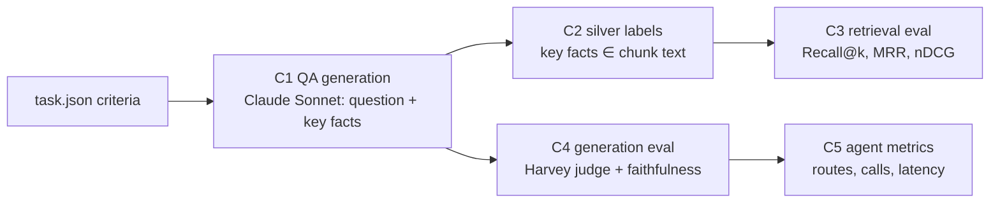

# 05 · Evaluation

## The problem
Harvey LAB grades *agent deliverables* (memos) with rubric criteria, and has **no retrieval gold labels**: `criteria[].sources` is empty in every task. So we build a retrieval + QA eval from the rubric itself.

## Pipeline (`src/hrag/eval/`)

**C1 · QA generation** (`build_qa.py`): sample 14 non-drafting tasks × 8 criteria. One Sonnet call per task rewrites each criterion as:
- the *question a lawyer would ask the data room*, without revealing the answer
- an expected answer
- 0–4 **verbatim key facts** ("3,552", "VelaroConnect", "Section 7A")
- a kind: `fact` / `analysis` / `skip`

Drafting tasks are excluded, and `skip` criteria are dropped, because those criteria grade the lawyer's own deliverable (format, a proposal it should make) rather than what the documents say.

**C2 · Silver labels:** a chunk of the *same matter* is gold if it contains the key facts (all of 1–2 facts, otherwise ≥ 2/3 of them; normalised, with "1,242" ≡ "1242"). Questions whose facts match more than 8 chunks are left unlabelled (too generic). *Silver, not gold:* cheap, objective and reproducible; good for **comparing configurations**, not for absolute claims.

**C3 · Retrieval** (`run_eval.py retrieval`, no LLM cost): every combination of index variant `raw` / `header` / `ctx` × `bm25` / `dense` / `hybrid` / `hybrid+rerank`, scored by:
- **Recall@k** (hit rate)
- **MRR**
- **nDCG@10**

**CRAG calibration** (`run_eval.py calibrate`): the top rerank score for answerable questions (positives) vs. the same questions asked in another matter's data room (cross-matter negatives). τ_low is the lowest positive score and τ_high is just above the highest negative; the band in between is LLM-graded.

**Unanswerable questions** (`run_eval.py negatives`): the same cross-matter negatives run end to end through single-shot and the agent. A Haiku judge checks whether each answer declined instead of answering from look-alike evidence.

**C4 · Generation** (`run_eval.py generation`): systems compared on the same questions:
- `naive`: dense-only, raw-text index, top-8 chunks, one generation call
- `single_shot`: hybrid + rerank on the contextual index, top-8 chunks, one call (advanced but fixed)
- `agent`: the LangGraph Adaptive-RAG + CRAG module
- `agent:simple` / `agent:complex`: forced routes, for the Adaptive-RAG ablation

Metrics:
- **Harvey-judge pass rate:** Harvey's own `rubric_criterion.txt` prompt against the *original* `match_criteria`, split by fact and analysis
- **faithfulness:** Haiku checks every claim against the evidence
- **abstention rate**
- **evidence-has-gold:** retrieval recall inside the full system
- **evidence words:** what CRAG refinement removes
- **LLM calls and latency per question**
- **route distribution**

Every eval item is a traced span (`eval.item`), so failures can be opened in Phoenix.

**Long runs and the subscription limit.** A session-limit error (`llm.QuotaError`) is raised at once instead of being
retried, and the run stops scheduling new questions. `--resume` (`resume=True`) keeps every finished answer and runs only
the missing (question, system) pairs, so a run that hit the limit is simply restarted after the reset. Before this, such
errors were retried and recorded as failures: 18 of 24 runs of the `ctx` unanswerable test were lost that way.

**Paired statistics** (`stats.py`, no LLM calls). Every system answers the same questions, so each question gives a
paired difference. Questions come up to 8 per matter, from one matter's rubric, so they are not independent: the 95%
confidence interval comes from a bootstrap that resamples whole matters, and binary metrics get a paired randomization
test that flips the signs of whole matters together (exact for ≤ 16 matters). See [How sure are we?](#how-sure-are-we).

## Results
Run on a Colab T4 with `notebooks/02_demo_and_eval.ipynb`. The JSON outputs are in `artifacts/eval/`.

<!-- RESULTS:START -->
**Retrieval** (57 questions with silver labels; searched within the matter's data room unless marked corpus-wide; `foreign@5` = share of top-5 hits from other matters)

| variant / mode | recall@1 | recall@5 | recall@10 | mrr | ndcg@10 | foreign@5 | ms_per_query |
|---|---|---|---|---|---|---|---|
| `raw/bm25` | 0.614 | 0.895 | 0.965 | 0.745 | 0.653 | 0.0 | 13 |
| `raw/dense` | 0.614 | 0.895 | 0.947 | 0.728 | 0.586 | 0.0 | 56 |
| `raw/hybrid` | 0.684 | 0.912 | 0.965 | 0.784 | 0.672 | 0.0 | 54 |
| `raw/hybrid+rerank` | 0.614 | 0.877 | 0.912 | 0.734 | 0.649 | 0.0 | 958 |
| `raw/dense (corpus-wide)` | 0.596 | 0.86 | 0.912 | 0.706 | 0.546 | 0.168 | 56 |
| `raw/hybrid+rerank (corpus-wide)` | 0.614 | 0.842 | 0.912 | 0.718 | 0.627 | 0.07 | 1001 |
| `header/bm25` | 0.649 | 0.895 | 0.965 | 0.754 | 0.671 | 0.0 | 11 |
| `header/dense` | 0.649 | 0.825 | 0.93 | 0.729 | 0.605 | 0.0 | 61 |
| `header/hybrid` | 0.667 | 0.912 | 0.982 | 0.777 | 0.667 | 0.0 | 57 |
| `header/hybrid+rerank` | 0.702 | 0.86 | 0.912 | 0.77 | 0.687 | 0.0 | 1047 |
| `header/dense (corpus-wide)` | 0.649 | 0.825 | 0.877 | 0.719 | 0.555 | 0.165 | 52 |
| `header/hybrid+rerank (corpus-wide)` | 0.684 | 0.842 | 0.912 | 0.758 | 0.653 | 0.074 | 1013 |
| `ctx/bm25` | 0.649 | 0.877 | 0.947 | 0.748 | 0.666 | 0.0 | 10 |
| `ctx/dense` | 0.667 | 0.842 | 0.93 | 0.737 | 0.605 | 0.0 | 56 |
| `ctx/hybrid` | 0.632 | 0.877 | 0.965 | 0.74 | 0.633 | 0.0 | 52 |
| `ctx/hybrid+rerank` | 0.684 | 0.842 | 0.912 | 0.752 | 0.669 | 0.0 | 1072 |
| `ctx/dense (corpus-wide)` | 0.614 | 0.789 | 0.912 | 0.695 | 0.53 | 0.172 | 50 |
| `ctx/hybrid+rerank (corpus-wide)` | 0.684 | 0.842 | 0.912 | 0.753 | 0.655 | 0.067 | 1043 |

**CRAG calibration** (variant `ctx`): top rerank score for answerable questions (positives) vs. the same questions asked against another matter's data room (negatives). Suggested thresholds `{'crag_high': 0.95, 'crag_low': 0.09}`; coverage `{'correct_pos': 0.902, 'incorrect_neg': 0.719, 'ambiguous_share': 0.202}`

| top rerank score | positives | gold_retrieved | negatives |
|---|---|---|---|
| [0.00,0.10) | 1 | 1.0 | 42 |
| [0.10,0.30) | 0 |  | 4 |
| [0.30,0.50) | 0 |  | 3 |
| [0.50,0.70) | 1 | 1.0 | 1 |
| [0.70,0.90) | 1 | 1.0 | 5 |
| [0.90,0.95) | 4 | 0.5 | 2 |
| [0.95,0.99) | 12 | 0.92 | 0 |
| [0.99,1.00) | 38 | 0.92 | 0 |

**Generation** (**final**, Colab T4, `ctx` index, 30 questions, after the refinement fix; Harvey rubric judge = Claude Sonnet)

| system | n | pass_rate | pass_rate_fact | pass_rate_analysis | faithful_rate | abstain_rate | evidence_has_gold | avg_evidence_words | avg_llm_calls | avg_seconds | routes |
|---|---|---|---|---|---|---|---|---|---|---|---|
| `agent` | 30 | 0.967 | 0.95 | 1.0 | 0.5 | 0.067 | 0.944 | 1201.0 | 3.733 | 28.37 | simple:24, complex:6 |
| `naive` | 30 | 0.9 | 0.95 | 0.8 | 0.7 | 0.1 | 0.944 | 1978.267 | 1.0 | 11.407 | fixed:30 |
| `single_shot` | 30 | 0.933 | 0.95 | 0.9 | 0.633 | 0.067 | 0.889 | 2226.733 | 1.0 | 12.747 | fixed:30 |

**Generation** (**final** Adaptive-RAG ablation, Colab T4, `ctx` index, 20 questions, after the fix; Harvey rubric judge = Claude Sonnet)

| system | n | pass_rate | pass_rate_fact | pass_rate_analysis | faithful_rate | abstain_rate | evidence_has_gold | avg_evidence_words | avg_llm_calls | avg_seconds | routes |
|---|---|---|---|---|---|---|---|---|---|---|---|
| `agent` | 20 | 0.9 | 0.929 | 0.833 |  | 0.0 | 0.857 | 1165.25 | 3.45 | 34.59 | simple:16, complex:4 |
| `agent:complex` | 20 | 0.9 | 0.929 | 0.833 |  | 0.0 | 1.0 | 2235.15 | 6.6 | 52.725 | complex:20 |
| `agent:simple` | 20 | 0.9 | 0.929 | 0.833 |  | 0.0 | 0.929 | 809.15 | 1.45 | 18.62 | simple:20 |

**Generation** (first Colab run, BEFORE the refinement fix, same 30 questions; Harvey rubric judge = Claude Sonnet)

| system | n | pass_rate | pass_rate_fact | pass_rate_analysis | faithful_rate | abstain_rate | evidence_has_gold | avg_evidence_words | avg_llm_calls | avg_seconds | routes |
|---|---|---|---|---|---|---|---|---|---|---|---|
| `agent` | 30 | 0.867 | 0.85 | 0.9 | 0.7 | 0.167 | 0.889 | 335.967 | 3.133 | 24.147 | simple:27, complex:3 |
| `naive` | 30 | 0.9 | 0.95 | 0.8 | 0.633 | 0.1 | 0.944 | 1978.267 | 1.0 | 11.153 | fixed:30 |
| `single_shot` | 30 | 0.967 | 0.95 | 1.0 | 0.667 | 0.1 | 0.889 | 2226.733 | 1.0 | 12.543 | fixed:30 |

**Generation** (first Colab Adaptive-RAG ablation, BEFORE the fix, same 20 questions; Harvey rubric judge = Claude Sonnet)

| system | n | pass_rate | pass_rate_fact | pass_rate_analysis | faithful_rate | abstain_rate | evidence_has_gold | avg_evidence_words | avg_llm_calls | avg_seconds | routes |
|---|---|---|---|---|---|---|---|---|---|---|---|
| `agent` | 20 | 0.9 | 0.857 | 1.0 |  | 0.1 | 0.857 | 443.15 | 4.1 | 39.68 | simple:16, complex:4 |
| `agent:complex` | 20 | 0.85 | 0.857 | 0.833 |  | 0.1 | 0.929 | 873.95 | 7.6 | 66.525 | complex:20 |
| `agent:simple` | 20 | 0.85 | 0.857 | 0.833 |  | 0.15 | 0.857 | 280.05 | 1.45 | 19.61 | simple:20 |

**Generation** (targeted local check of the fix, `header` index, 4 failed + 6 passed questions; Harvey rubric judge = Claude Sonnet)

| system | n | pass_rate | pass_rate_fact | pass_rate_analysis | faithful_rate | abstain_rate | evidence_has_gold | avg_evidence_words | avg_llm_calls | avg_seconds | routes |
|---|---|---|---|---|---|---|---|---|---|---|---|
| `agent` | 10 | 0.9 | 0.8 | 1.0 | 0.5 | 0.0 | 0.714 | 871.1 | 4.3 | 138.96 | complex:2, simple:8 |

**Unanswerable questions** (`header` index; each question asked in ANOTHER matter's data room; judged by Claude Haiku: did the answer decline?)

| system | n | declined_rate | hallucination_rate | avg_llm_calls |
|---|---|---|---|---|
| `single_shot` | 12 | 0.917 | 0.083 | 1.0 |
| `agent` | 12 | 0.833 | 0.167 | 7.42 |
<!-- RESULTS:END -->

## Analysis (honest reading of the numbers)

**Retrieval (57 labelled questions; one question = 1.75 points, so small gaps are noise)**
- **Hybrid beats either single retriever.** On the `raw` index: R@1 0.684 vs. 0.614 / 0.614 (BM25 / dense), MRR 0.784 vs. 0.745 / 0.728. The best R@10 is `header/hybrid` (0.982).
- **Reranking trades recall@5–10 for precision@1.** On `header`, R@1 rises 0.667 → 0.702 while R@5 falls 0.912 → 0.860. With silver labels, the reranker sometimes prefers a chunk that answers the question semantically but lacks the verbatim facts.
- **Contextual Retrieval did not measurably help here** (`ctx/hybrid` R@5 0.877 vs. `header/hybrid` 0.912). Likely reasons:
  1. The labels are verbatim-fact matches, and generic context words dilute BM25 (`ctx/bm25` 0.877 vs. `header/bm25` 0.895).
  2. Within one matter (~186 chunks) there is little ambiguity left for context to resolve, and the cheap deterministic header already carries the document and section.
  3. A 3B model's contexts are often generic ("Lists the parties' signatures and the date of the agreement").

  The technique is built to disambiguate across a large corpus, and corpus-wide it only ties (R@1 0.684 = `header`).
- **Scoping matters.** Corpus-wide dense retrieval puts **~17% of top-5 hits from other matters** (`foreign@5` 0.165–0.172). Hybrid + rerank cuts that to ~7%, and scoping to the data room removes it entirely.

**CRAG calibration on the `ctx` index** gave τ_high 0.95 / τ_low 0.09. The error-free-band rule is sensitive to single outliers (one negative scored 0.95, one positive 0.09), so the ambiguous band was wide and Haiku graded more often (90 `crag_grade` calls). A percentile rule (e.g. 5th/95th) would be more robust; that's the next step.

**Generation, first Colab run (before the fix; 30 questions, `ctx` index)**
- Pass rates: naive **0.90**, single-shot **0.967**, agent **0.867**.
- Paired (agent vs. single-shot): 26 both pass, **3 fail only for the agent**, 1 both fail (McNemar p = 0.25).
- **Root cause of 3 of the 4 agent failures:** the gold chunk *was* retrieved and CRAG graded it `correct` (0.98–1.00). Then **knowledge refinement pruned it to 73–475 words**. (The 4th, C-100, was pruned too, but its deeper cause is a chunking miss shared by all systems; see below.) These were list, enumeration and clause questions ("each change the DOJ made", the carve-out text), where individual sentences don't look relevant on their own. This is the cost of choosing refinement over parent-child ([07](07-decision-log.md) #7).
- **Fix:** hits scored ≥ τ_high (clearly relevant) are passed **whole**; only marginal hits are strip-filtered. A targeted local check (`header` index, the 4 failed + 6 passed questions) predicted that 3 of the 4 would flip with no regressions.

**Generation, final Colab run (after the fix; same 30 questions, `ctx` index)**
- Pass rates: **agent 0.967 (29/30)**, single-shot 0.933 (28/30), naive 0.90 (27/30).
- **The fix did exactly what the diagnosis predicted.** The 3 over-pruned questions (C-016, C-005, C-046) flipped from fail to pass, and none of the agent's other passes regressed.
- Paired (agent vs. single-shot): 28 both pass, 1 passes only for the agent, 1 both fail (McNemar p = 1.0). **Statistically a tie.**
- **Run-to-run noise, measured:** with unchanged code, single-shot flipped one question (C-046, pass → fail), and the faithfulness of naive / single-shot moved by about ±7 points (0.633 → 0.70 and 0.667 → 0.633). So one question of pass rate, or a few points of faithfulness, is within noise at n = 30.
- **The remaining failure (C-100, "list all 25 custodians") fails for all three systems, and it is a chunking issue.**
  - The 25 names *are* in the data room, in three appendix tables (Appendix A/B/C).
  - Each table became its own chunk, starting with `| No. | Full Name | Title |…` under the section path "APPENDIX A". The word "custodians" lives only in the caption paragraph just before each table, which went into a separate chunk.
  - The tables rank 20th–30th or lower, outside the top-8. The LLM context lines ("Appendix A – Wave 1 Custodians") didn't lift them enough.
  - **Next step:** attach a table's caption to the table chunk, and for "list all" questions retrieve the whole section.
- **What the fix cost:**
  - Evidence per answer rose from 336 to **1,201 words** (still **−46%** vs. single-shot's 2,227).
  - The agent's faithfulness fell from 0.70 to **0.50**: a 20-point paired drop, 95% CI [−37, −3] over matters, but
    the matter-level randomization test gives p = 0.11, so it is borderline rather than established (see
    [How sure are we?](#how-sure-are-we)). With whole chunks the generator writes longer answers with more unlabelled characterisations (e.g. "It is a legend, not an access control"). Correctness was bought with some faithfulness. A claim-verification node, or stricter "Analysis:" labelling, is the next step.
  - **3.7 LLM calls and 28 s** per question, vs. 1 call and 13 s.

**Adaptive-RAG**
- **Final run (20 questions): all three policies score 0.90.** Adaptive costs **3.45 calls / 35 s**, vs. always-complex 6.6 / 53 s and always-simple 1.45 / 19 s.
- In the first run adaptive led 0.90 vs. 0.85 / 0.85. That one-question edge did **not** reproduce, so it was noise.
- On this set the router sends ~80% of questions down the simple path. **Always-simple is the cheapest at equal accuracy.** Adaptive halves the cost of always-complex, but its accuracy value would need genuinely multi-hop questions to show.

**Unanswerable questions** (12 questions, each asked in another matter's data room; `header` index, local):
- Single-shot declined **11/12**; the agent declined **10/12** at 7.4 vs. 1 LLM calls.
- The difference is one question (noise), but the hypothesis that the agent abstains better is **not supported**. Two reasons from the traces:
  1. The **shared grounded generator prompt** ("say 'the documents do not establish …'") already makes Sonnet decline when evidence is unrelated, in both systems.
  2. **CRAG's corrective loop cuts both ways.** Rewrite + HyDE *searches harder* and can surface look-alike evidence from the wrong data room (e.g. another matter's IT memo on employees' personal devices), which the generator then answers from.

  A stricter grader on corrective rounds, or abstaining when only rewritten queries find evidence, would be the next step.
- The `ctx` rerun of this test **hit the Claude subscription's session limit** ("You've hit your session limit"): 18 of 24 runs errored. It is excluded from the tables, and the raw records are kept as `unanswerable_ctx_INCOMPLETE_session_limit.jsonl`. Operational lesson: at ~700 calls per full eval session, subscription quota is a real constraint, which is what the API-key fallback is for.

**Conclusion**
- After a fix that the per-node traces pointed to, **the agent is the best-scoring system (29/30 vs. 28/30 vs. 27/30)**, but the gaps are within measured run-to-run noise. The honest claim is **"at least on par"**, not "better".
- **What the agentic layer adds:**
  - **Efficiency:** 46% less context than single-shot (85% before the fix); adaptive routing at half the cost of always-complex.
  - **Auditability:** every route, CRAG verdict and rewrite is logged and traced.
  - **A diagnosable structure:** each failure traced to one node (refinement over-pruning; corrective search finding look-alikes; table/caption chunking). The over-pruning fix was predicted from the traces and confirmed question by question on Colab.
- **What it costs:** ~3.7× the LLM calls, ~2× the latency, and in its current form lower faithfulness.
- **The accuracy foundation is the retrieval stack** (structure-aware chunks, hybrid + RRF, rerank, data-room scoping): even naive dense RAG scores 0.90 with this generator.

## How sure are we?
`python -m hrag.eval.stats <gen file> --a <system> --b <system>` on the committed records (no LLM calls). Diff = a − b;
95% CI from a bootstrap over matters; p from the matter-level paired randomization test.

| comparison (records) | questions / matters | pass diff [95% CI], p | faithful diff [95% CI], p | other paired differences |
|---|---|---|---|---|
| agent − single-shot (final run) | 30 / 13 | +3.3 [0.0, +10.0], p = 1.0 | −13.3 [−37.0, +6.2], p = 0.36 | evidence −1,026 words [−1,277, −728]; +2.7 LLM calls [+1.4, +4.2]; +15.6 s [+8.4, +22.0] |
| single-shot − naive (final run) | 30 / 13 | +3.3 [0.0, +11.8], p = 1.0 | −6.7 [−26.7, +18.5], p = 0.84 | |
| agent − naive (final run) | 30 / 13 | +6.7 [0.0, +16.0], p = 0.50 | −20.0 [−45.2, +12.5], p = 0.32 | |
| agent after − before the refinement fix | 30 / 13 | +10.0 [0.0, +21.9], p = 0.50 | −20.0 [−37.1, −3.1], p = 0.11 | evidence +865 words [+664, +1,079] |
| adaptive − always-simple (ablation) | 20 / 10 | 0.0, p = 1.0 | – | +2.0 LLM calls [+1.1, +3.0]; +16 s [+8, +25] |
| adaptive − always-complex (ablation) | 20 / 10 | 0.0, p = 1.0 | – | −3.2 LLM calls [−5.3, −1.0]; −18 s [−28, −8] |

What holds and what doesn't:
- **No pass-rate or faithfulness difference between any two systems is significant.** With 30 questions from 13
  matters, a 95% CI is about ±10 points wide for pass and about ±25 for faithfulness.
- **The cost and context differences are significant:** the agent uses ~46% less evidence than single-shot, at ~3.7×
  the calls; adaptive routing halves always-complex's calls at equal accuracy.
- **The faithfulness drop after the refinement fix is borderline** (CI excludes 0, p = 0.11), and a deeper look at the
  faithfulness judge (below) suggests much of its movement is judge noise.

## What a deeper evaluation showed (follow-up work)
A follow-up on the branch `agent-improvements` grew the corpus by 13 deal-regulatory matters, wrote 126 questions from
16 matters that have no questions here, and ran single-shot and the agent on them. It found that **this eval design cannot
separate the two systems**, for reasons that apply to the numbers above:
1. **The faithfulness judge is mostly noise.** On 78 questions where the agent passed exactly single-shot's evidence
   to the identical prompt, the binary Haiku verdict disagreed on 34 (44%), about what two coin flips at p ≈ 0.68
   would give. One minor slip in a ~600-word answer (a title inferred from a file name) flips the whole verdict.
2. **The pass rate is saturated.** Both systems pass ~95% of rubric questions, so only a handful of questions can
   ever differ.
3. **Some rubrics contradict the documents.** An audit against the data room found 5 of the 126 criteria contradicted
   by the documents (both systems answered correctly and failed), and 7 that turn on outside legal judgment.
4. **Most questions run the same pipeline twice.** On simple questions the agent retrieves exactly what single-shot
   does, so the difference there is pure sampling noise.

The fix was a different eval: the rubric items audited against the documents, a claim-level groundedness judge (only
*material* errors count), a pairwise judge where the two answers differ (seeded random order), reuse of single-shot's
answer where the agent's input is identical (removing the noise in item 4), and the matter-level statistics above.
With it, on 126 questions from 16 matters, the pass rate still tied (agent +0.8 points, 95% CI [−1.6, +3.9]), but where
the agent took its own path (48 questions) the pairwise judge preferred its answer **36 times vs. 8, with 4 ties**
(p < 0.001, matter-level; the answer shown first won 48% of the time, so no position bias). Caveats: the judge is
Sonnet grading Sonnet answers, and those test questions had been read during the diagnosis. That branch also changed
the agent (the question itself is always searched first, the planner sees that search, link-finding sufficiency, a
corrective round that looks only at new chunks); those changes are not on `main`.

## Findings that changed the design
- **The silver labels favour BM25 by construction.** A chunk is gold *because* it contains the verbatim key facts, which is exactly what BM25 matches. So BM25's strong showing within a matter is partly a labelling artefact. Hybrid search is the safer default: it never loses much to the best single retriever and wins on Recall@5.
- **Searching only within the matter makes the task easy** (~186 chunks per matter). Corpus-wide rows show the harder setting and the **contamination** (`foreign@5`: share of top-5 hits from *other* matters) that scoping removes.
- **Reranker scores saturate on answerable questions** (52/60 top scores ≥ 0.95 in the first calibration), so a reranker-only CRAG evaluator would call nearly everything "correct". Calibration therefore adds **cross-matter negatives**: every question is also asked against another matter's data room, where its answer can't exist. τ_high and τ_low are chosen from positives vs. negatives, and the agent loads them from `artifacts/eval/crag_calibration.json`. The band in between goes to the Haiku grader.

## Limitations
- Silver labels can miss gold chunks that paraphrase a fact ("fifty percent") and can credit chunks that mention a figure in passing. Fine for relative comparisons; absolute recall is approximate.
- One judge model (Claude), not Harvey's dual-judge profile (Claude + GPT), and our answers are short QA answers rather than full memos. Criteria written for memos are judged "in substance" for the question asked.
- The sample is small (30 questions from 13 matters), so pass-rate differences under ~10 points and faithfulness
  differences under ~25 points are within the 95% CI ([How sure are we?](#how-sure-are-we)).
- The binary faithfulness judge is noisy: on identical inputs it disagreed with itself 44% of the time in the
  follow-up ([above](#what-a-deeper-evaluation-showed-follow-up-work)). Treat faithfulness differences as indicative.
- The CRAG thresholds are calibrated on the same questions used in the generation eval. It's only two parameters, so overfitting risk is low, but it is disclosed here.
- **No held-out set for the fix.** The refinement fix was chosen after inspecting the first run's failures and confirmed on the same 30 questions. It targets a mechanism (don't shred chunks scored ≥ τ_high), not specific questions, but a fresh question sample would be the clean confirmation.
- **Run-to-run noise** (measured on unchanged pipelines): about ±1 question of pass rate and about ±7 points of faithfulness at n = 30.
