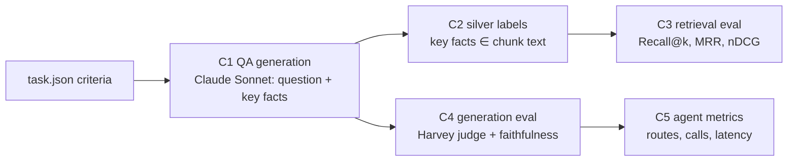

# 05 · Evaluation

## The problem
Harvey LAB grades *agent deliverables* (memos) with rubric criteria, and has **no retrieval gold labels**: `criteria[].sources` is empty in every task. So we build a retrieval + QA eval from the rubric itself.

## Pipeline (`src/hrag/eval/`)

**C1 · QA generation** (`build_qa.py`): sample 14 non-drafting tasks × 8 criteria. One Sonnet call per task rewrites each criterion as:
- the *question a lawyer would ask the data room*, without revealing the answer
- an expected answer
- 0–4 **verbatim key facts** ("3,552", "VelaroConnect", "Section 7A")
- a kind: `fact` / `analysis` / `skip`

Drafting tasks are excluded, and `skip` criteria are dropped, because those criteria grade the lawyer's own deliverable (format, a proposal it should make) rather than what the documents say.

**C2 · Silver labels:** a chunk of the *same matter* is gold if it contains the key facts (all of 1–2 facts, otherwise ≥ 2/3 of them; normalised, with "1,242" ≡ "1242"). Questions whose facts match more than 8 chunks are left unlabelled (too generic). *Silver, not gold:* cheap, objective and reproducible; good for **comparing configurations**, not for absolute claims.

**C3 · Retrieval** (`run_eval.py retrieval`, no LLM cost): every combination of index variant `raw` / `header` / `ctx` × `bm25` / `dense` / `hybrid` / `hybrid+rerank`, scored by:
- **Recall@k** (hit rate)
- **MRR**
- **nDCG@10**

**CRAG calibration** (`run_eval.py calibrate`): buckets of the top rerank score against the share of questions whose gold chunk was retrieved. τ_high and τ_low are read off this table.

**C4 · Generation** (`run_eval.py generation`): systems compared on the same questions:
- `naive`: dense-only, raw-text index, top-8 chunks, one generation call
- `single_shot`: hybrid + rerank on the contextual index, top-8 chunks, one call (advanced but fixed)
- `agent`: the LangGraph Adaptive-RAG + CRAG module
- `agent:simple` / `agent:complex`: forced routes, for the Adaptive-RAG ablation

Metrics:
- **Harvey-judge pass rate:** Harvey's own `rubric_criterion.txt` prompt against the *original* `match_criteria`, split by fact and analysis
- **faithfulness:** Haiku checks every claim against the evidence
- **abstention rate**
- **evidence-has-gold:** retrieval recall inside the full system
- **evidence words:** what CRAG refinement removes
- **LLM calls and latency per question**
- **route distribution**

Every eval item is a traced span (`eval.item`), so failures can be opened in Phoenix.

## Results
Run on a Colab T4 with `notebooks/02_demo_and_eval.ipynb`. The JSON outputs are in `artifacts/eval/`.

<!-- RESULTS:START -->
**Retrieval** (57 questions with silver labels, scoped to the matter's data room)

| variant / mode | recall@1 | recall@5 | recall@10 | mrr | ndcg@10 | foreign@5 | ms_per_query |
|---|---|---|---|---|---|---|---|
| `raw/bm25` | 0.614 | 0.895 | 0.965 | 0.745 | 0.653 | 0.0 | 13 |
| `raw/dense` | 0.614 | 0.895 | 0.947 | 0.728 | 0.586 | 0.0 | 56 |
| `raw/hybrid` | 0.684 | 0.912 | 0.965 | 0.784 | 0.672 | 0.0 | 54 |
| `raw/hybrid+rerank` | 0.614 | 0.877 | 0.912 | 0.734 | 0.649 | 0.0 | 958 |
| `raw/dense (corpus-wide)` | 0.596 | 0.86 | 0.912 | 0.706 | 0.546 | 0.168 | 56 |
| `raw/hybrid+rerank (corpus-wide)` | 0.614 | 0.842 | 0.912 | 0.718 | 0.627 | 0.07 | 1001 |
| `header/bm25` | 0.649 | 0.895 | 0.965 | 0.754 | 0.671 | 0.0 | 11 |
| `header/dense` | 0.649 | 0.825 | 0.93 | 0.729 | 0.605 | 0.0 | 61 |
| `header/hybrid` | 0.667 | 0.912 | 0.982 | 0.777 | 0.667 | 0.0 | 57 |
| `header/hybrid+rerank` | 0.702 | 0.86 | 0.912 | 0.77 | 0.687 | 0.0 | 1047 |
| `header/dense (corpus-wide)` | 0.649 | 0.825 | 0.877 | 0.719 | 0.555 | 0.165 | 52 |
| `header/hybrid+rerank (corpus-wide)` | 0.684 | 0.842 | 0.912 | 0.758 | 0.653 | 0.074 | 1013 |
| `ctx/bm25` | 0.649 | 0.877 | 0.947 | 0.748 | 0.666 | 0.0 | 10 |
| `ctx/dense` | 0.667 | 0.842 | 0.93 | 0.737 | 0.605 | 0.0 | 56 |
| `ctx/hybrid` | 0.632 | 0.877 | 0.965 | 0.74 | 0.633 | 0.0 | 52 |
| `ctx/hybrid+rerank` | 0.684 | 0.842 | 0.912 | 0.752 | 0.669 | 0.0 | 1072 |
| `ctx/dense (corpus-wide)` | 0.614 | 0.789 | 0.912 | 0.695 | 0.53 | 0.172 | 50 |
| `ctx/hybrid+rerank (corpus-wide)` | 0.684 | 0.842 | 0.912 | 0.753 | 0.655 | 0.067 | 1043 |

**CRAG calibration** (variant `ctx`): top rerank score for answerable questions (positives) vs. the same questions asked against another matter's data room (negatives). Suggested thresholds `{'crag_high': 0.95, 'crag_low': 0.09}`; coverage `{'correct_pos': 0.902, 'incorrect_neg': 0.719, 'ambiguous_share': 0.202}`

| top rerank score | positives | gold_retrieved | negatives |
|---|---|---|---|
| [0.00,0.10) | 1 | 1.0 | 42 |
| [0.10,0.30) | 0 |  | 4 |
| [0.30,0.50) | 0 |  | 3 |
| [0.50,0.70) | 1 | 1.0 | 1 |
| [0.70,0.90) | 1 | 1.0 | 5 |
| [0.90,0.95) | 4 | 0.5 | 2 |
| [0.95,0.99) | 12 | 0.92 | 0 |
| [0.99,1.00) | 38 | 0.92 | 0 |

**Generation** (Adaptive-RAG ablation, Colab T4, `ctx` index, 20 questions; Harvey rubric judge = Claude Sonnet)

| system | n | pass_rate | pass_rate_fact | pass_rate_analysis | faithful_rate | abstain_rate | evidence_has_gold | avg_evidence_words | avg_llm_calls | avg_seconds | routes |
|---|---|---|---|---|---|---|---|---|---|---|---|
| `agent` | 20 | 0.9 | 0.857 | 1.0 |  | 0.1 | 0.857 | 443.15 | 4.1 | 39.68 | simple:16, complex:4 |
| `agent:complex` | 20 | 0.85 | 0.857 | 0.833 |  | 0.1 | 0.929 | 873.95 | 7.6 | 66.525 | complex:20 |
| `agent:simple` | 20 | 0.85 | 0.857 | 0.833 |  | 0.15 | 0.857 | 280.05 | 1.45 | 19.61 | simple:20 |

**Generation** (Colab T4, `ctx` index, 30 questions; Harvey rubric judge = Claude Sonnet)

| system | n | pass_rate | pass_rate_fact | pass_rate_analysis | faithful_rate | abstain_rate | evidence_has_gold | avg_evidence_words | avg_llm_calls | avg_seconds | routes |
|---|---|---|---|---|---|---|---|---|---|---|---|
| `agent` | 30 | 0.867 | 0.85 | 0.9 | 0.7 | 0.167 | 0.889 | 335.967 | 3.133 | 24.147 | simple:27, complex:3 |
| `naive` | 30 | 0.9 | 0.95 | 0.8 | 0.633 | 0.1 | 0.944 | 1978.267 | 1.0 | 11.153 | fixed:30 |
| `single_shot` | 30 | 0.967 | 0.95 | 1.0 | 0.667 | 0.1 | 0.889 | 2226.733 | 1.0 | 12.543 | fixed:30 |
<!-- RESULTS:END -->

## Analysis (honest reading of the numbers)

**Retrieval (57 labelled questions; one question = 1.75 points, so small gaps are noise)**
- **Hybrid beats either single retriever.** On the `raw` index: R@1 0.684 vs. 0.614 / 0.614 (BM25 / dense), MRR 0.784 vs. 0.745 / 0.728. The best R@10 is `header/hybrid` (0.982).
- **Reranking trades recall@5–10 for precision@1.** On `header`, R@1 rises 0.667 → 0.702 while R@5 falls 0.912 → 0.860. With silver labels, the reranker sometimes prefers a chunk that answers the question semantically but lacks the verbatim facts.
- **Contextual Retrieval did not measurably help here** (`ctx/hybrid` R@5 0.877 vs. `header/hybrid` 0.912). Likely reasons:
  1. The labels are verbatim-fact matches, and generic context words dilute BM25 (`ctx/bm25` 0.877 vs. `header/bm25` 0.895).
  2. Within one matter (~186 chunks) there is little ambiguity left for context to resolve, and the cheap deterministic header already carries the document and section.
  3. A 3B model's contexts are often generic ("Lists the parties' signatures and the date of the agreement").

  The technique is built to disambiguate across a large corpus, and corpus-wide it only ties (R@1 0.684 = `header`).
- **Scoping matters.** Corpus-wide dense retrieval puts **~17% of top-5 hits from other matters** (`foreign@5` 0.165–0.172). Hybrid + rerank cuts that to ~7%, and scoping to the data room removes it entirely.

**CRAG calibration on the `ctx` index** gave τ_high 0.95 / τ_low 0.09. The error-free-band rule is sensitive to single outliers (one negative scored 0.95, one positive 0.09), so the ambiguous band was wide and Haiku graded more often (90 `crag_grade` calls). A percentile rule (e.g. 5th/95th) would be more robust; that's the next step.

**Generation (30 questions, Colab, `ctx` index)**
- Pass rates: naive **0.90**, single-shot **0.967**, agent **0.867**.
- Paired view (agent vs. single-shot): 26 both pass, **3 fail only for the agent**, 1 both fail. An exact McNemar test on 3 vs. 0 discordant pairs gives p = 0.25, so this isn't significant, but it is a real pattern, explained next.
- **Root cause of every agent failure:** the gold chunk *was* retrieved and CRAG graded it `correct` (0.98–1.00). Then **knowledge refinement pruned it to 30–475 words**. The failing questions were "list all 25 custodians", "each change the DOJ made" and clause text. In lists, enumerations and clauses, individual sentences don't look relevant on their own, so strip-level scoring drops them, and the generator then honestly says "the documents do not establish…". This is the cost of choosing refinement over parent-child ([07](07-decision-log.md) #7), and the eval shows exactly where it bites.
- **Fix:** hits scored ≥ τ_high (clearly relevant) are passed **whole**; only marginal hits are strip-filtered. CRAG's goal is to drop *noise*, not to shred clearly relevant evidence. The re-run is below.
- **What the agent buys even on answerable questions:**
  - **−85% evidence** (336 vs. 2,227 words per answer)
  - the highest faithfulness (0.70 vs. 0.667 single-shot, 0.633 naive)
  - at 3.1 LLM calls and 24 s per question vs. 1 call and 12.5 s

**Adaptive-RAG (20 questions):** adaptive **0.90 at 4.1 calls / 40 s**, vs. always-complex 0.85 at 7.6 calls / 67 s and always-simple 0.85 at 1.45 calls / 20 s. The router sent 16/20 questions down the simple path. Adaptive matched or beat both fixed policies at about half the cost of always-complex. (n = 20, so one question is 5 points.)

**The bigger picture.** This QA set contains **only answerable, mostly single-passage questions**, where a strong fixed pipeline (hybrid + rerank + Sonnet) is already near the ceiling (96.7%). On such a set an agent can't win on accuracy and can only lose by over-abstaining or over-pruning. What the agent is *for* is the situation a fixed pipeline handles worst: **the answer isn't in the documents.** That is measured below with unanswerable questions.

## Findings that changed the design
- **The silver labels favour BM25 by construction.** A chunk is gold *because* it contains the verbatim key facts, which is exactly what BM25 matches. So BM25's strong showing within a matter is partly a labelling artefact. Hybrid search is the safer default: it never loses much to the best single retriever and wins on Recall@5.
- **Searching only within the matter makes the task easy** (~186 chunks per matter). Corpus-wide rows show the harder setting and the **contamination** (`foreign@5`: share of top-5 hits from *other* matters) that scoping removes.
- **Reranker scores saturate on answerable questions** (52/60 top scores ≥ 0.95 in the first calibration), so a reranker-only CRAG evaluator would call nearly everything "correct". Calibration therefore adds **cross-matter negatives**: every question is also asked against another matter's data room, where its answer can't exist. τ_high and τ_low are chosen from positives vs. negatives, and the agent loads them from `artifacts/eval/crag_calibration.json`. The band in between goes to the Haiku grader.

## Limitations
- Silver labels can miss gold chunks that paraphrase a fact ("fifty percent") and can credit chunks that mention a figure in passing. Fine for relative comparisons; absolute recall is approximate.
- One judge model (Claude), not Harvey's dual-judge profile (Claude + GPT), and our answers are short QA answers rather than full memos. Criteria written for memos are judged "in substance" for the question asked.
- The sample is small (tens of questions), so differences of a few points are noise.
- The CRAG thresholds are calibrated on the same questions used in the generation eval. It's only two parameters, so overfitting risk is low, but it is disclosed here.
