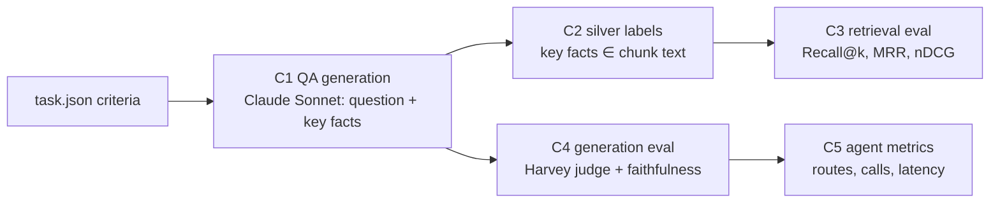

# 05 · Evaluation

## The problem
Harvey LAB grades *agent deliverables* (memos) with rubric criteria, and has **no retrieval gold labels**: `criteria[].sources` is empty in every task. So we build a retrieval + QA eval from the rubric itself.

## Pipeline (`src/hrag/eval/`)

**C1 · QA generation** (`build_qa.py`): sample 14 non-drafting tasks × 8 criteria. One Sonnet call per task rewrites each criterion as:
- the *question a lawyer would ask the data room*, without revealing the answer
- an expected answer
- 0–4 **verbatim key facts** ("3,552", "VelaroConnect", "Section 7A")
- a kind: `fact` / `analysis` / `skip`

Drafting tasks are excluded, and `skip` criteria are dropped, because those criteria grade the lawyer's own deliverable (format, a proposal it should make) rather than what the documents say.

**C2 · Silver labels:** a chunk of the *same matter* is gold if it contains the key facts (all of 1–2 facts, otherwise ≥ 2/3 of them; normalised, with "1,242" ≡ "1242"). Questions whose facts match more than 8 chunks are left unlabelled (too generic). *Silver, not gold:* cheap, objective and reproducible; good for **comparing configurations**, not for absolute claims.

**C3 · Retrieval** (`run_eval.py retrieval`, no LLM cost): every combination of index variant `raw` / `header` / `ctx` × `bm25` / `dense` / `hybrid` / `hybrid+rerank`, scored by:
- **Recall@k** (hit rate)
- **MRR**
- **nDCG@10**

**CRAG calibration** (`run_eval.py calibrate`): buckets of the top rerank score against the share of questions whose gold chunk was retrieved. τ_high and τ_low are read off this table.

**C4 · Generation** (`run_eval.py generation`): systems compared on the same questions:
- `naive`: dense-only, raw-text index, top-8 chunks, one generation call
- `single_shot`: hybrid + rerank on the contextual index, top-8 chunks, one call (advanced but fixed)
- `agent`: the LangGraph Adaptive-RAG + CRAG module
- `agent:simple` / `agent:complex`: forced routes, for the Adaptive-RAG ablation

Metrics:
- **Harvey-judge pass rate:** Harvey's own `rubric_criterion.txt` prompt against the *original* `match_criteria`, split by fact and analysis
- **faithfulness:** Haiku checks every claim against the evidence
- **abstention rate**
- **evidence-has-gold:** retrieval recall inside the full system
- **evidence words:** what CRAG refinement removes
- **LLM calls and latency per question**
- **route distribution**

Every eval item is a traced span (`eval.item`), so failures can be opened in Phoenix.

## Results
Run on a Colab T4 with `notebooks/02_demo_and_eval.ipynb`. The JSON outputs are in `artifacts/eval/`.

<!-- RESULTS:START -->
*Results are filled in from `artifacts/eval/*.json` after the Colab run.*
<!-- RESULTS:END -->

## Findings that changed the design
- **The silver labels favour BM25 by construction.** A chunk is gold *because* it contains the verbatim key facts, which is exactly what BM25 matches. So BM25's strong showing within a matter is partly a labelling artefact. Hybrid search is the safer default: it never loses much to the best single retriever and wins on Recall@5.
- **Searching only within the matter makes the task easy** (~186 chunks per matter). Corpus-wide rows show the harder setting and the **contamination** (`foreign@5`: share of top-5 hits from *other* matters) that scoping removes.
- **Reranker scores saturate on answerable questions** (52/60 top scores ≥ 0.95 in the first calibration), so a reranker-only CRAG evaluator would call nearly everything "correct". Calibration therefore adds **cross-matter negatives**: every question is also asked against another matter's data room, where its answer can't exist. τ_high and τ_low are chosen from positives vs. negatives, and the agent loads them from `artifacts/eval/crag_calibration.json`. The band in between goes to the Haiku grader.

## Limitations
- Silver labels can miss gold chunks that paraphrase a fact ("fifty percent") and can credit chunks that mention a figure in passing. Fine for relative comparisons; absolute recall is approximate.
- One judge model (Claude), not Harvey's dual-judge profile (Claude + GPT), and our answers are short QA answers rather than full memos. Criteria written for memos are judged "in substance" for the question asked.
- The sample is small (tens of questions), so differences of a few points are noise.
- The CRAG thresholds are calibrated on the same questions used in the generation eval. It's only two parameters, so overfitting risk is low, but it is disclosed here.
