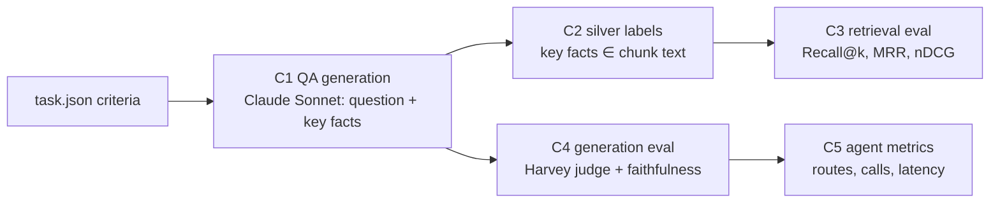

# 05 · Evaluation

## The problem
Harvey LAB grades *agent deliverables* (memos) with rubric criteria, and has **no retrieval gold labels**: `criteria[].sources` is empty in every task. So we build a retrieval + QA eval from the rubric itself.

## Pipeline (`src/hrag/eval/`)

**Splits.** `qa.jsonl` has a `split` field:
- **`dev`** (110 questions, 14 antitrust matters): every question used on `main`. They shaped the design: 30 tuned prompts and the refinement fix, 57 labelled ones set the CRAG thresholds and the retrieval choices.
- **`test`** (126 questions, 16 matters): the 4 antitrust matters with no questions on `main` plus the 12 non-drafting deal-regulatory matters added to the corpus ([01](01-dataset.md)). It began as a **matter-level** held-out set (no test matter appears in dev), but both runs were inspected and C-022/C-039 motivated later agent fixes. It is therefore a regression set now, not an untouched estimate. The post-freeze hard questions below are the clean comparison. (The demo also uses `analyze-iss-antitrust-transaction-structure`.)

**C1 · QA generation** (`build_qa.py`): `build` sampled 14 non-drafting tasks × 8 criteria (dev); `extend` adds 8 criteria for every non-drafting matter without questions (test), keeping existing questions untouched. One Sonnet call per task rewrites each criterion as:
- the *question a lawyer would ask the data room*, without revealing the answer
- an expected answer
- 0–4 **verbatim key facts** ("3,552", "VelaroConnect", "Section 7A")
- a kind: `fact` / `analysis` / `skip`

Drafting tasks are excluded, and `skip` criteria are dropped, because those criteria grade the lawyer's own deliverable (format, a proposal it should make) rather than what the documents say.

**C2 · Silver labels:** a chunk of the *same matter* is gold if it contains the key facts (all of 1–2 facts, otherwise ≥ 2/3 of them; normalised, with "1,242" ≡ "1242"). *Silver, not gold:* cheap, objective and reproducible; good for **comparing configurations**, not for absolute claims.
- When the facts match **more than 8 chunks** (too generic on their own; 25 dev questions on `main` were left unlabelled for this), one Sonnet call sees the question, expected answer and up to 30 of those matching chunks and picks the ones that state the answer (`gold_source: "llm"`, at most 8). The candidates come from string matching, never from our retriever, so the labels don't favour it.
- Result: dev 82/110 labelled (57 string + 25 LLM; was 57/110), test 98/126 (77 + 21). The rest have no verbatim facts (analysis questions) or facts that match nothing. `build_qa relabel --split dev` recomputes labels without regenerating questions.

**C3 · Retrieval** (`run_eval.py retrieval`, no LLM cost), **per split**: every combination of index variant `raw` / `header` / `ctx` × `bm25` / `dense` / `hybrid` / `hybrid+rerank` (reranker order replaces the hybrid order) / `hybrid+rerank(rrf)` (rank fusion of both, the default on this branch), scored by:
- **Recall@k** (hit rate)
- **MRR**
- **nDCG@10**

**CRAG calibration** (`run_eval.py calibrate`, **dev split only**): the top rerank score for answerable questions (positives) vs. the same questions asked in another matter's data room of the **same practice area** (cross-matter negatives). τ_low = 2nd percentile of the positives, τ_high = 98th percentile of the negatives (`CFG.crag_tail`); the band in between is LLM-graded. On `main` the rule was min/max (error-free), which one outlier per side could move ([04](04-agentic-module.md#crag-yan-et-al-2024)).

**Unanswerable questions** (`run_eval.py negatives`, test split, 40 questions): cross-matter negatives (same practice area) run end to end through single-shot and the agent. A Haiku judge checks whether each answer declined instead of answering from look-alike evidence.

**C4 · Generation** (`run_eval.py generation`, default: the whole test split): systems compared on the same questions:
- `naive`: dense-only, raw-text index, top-8 chunks, one generation call
- `single_shot`: hybrid + rerank on the `header` index, top-8 chunks, one call (advanced but fixed)
- `agent`: the LangGraph Adaptive-RAG + CRAG module
- `agent:simple` / `agent:complex`: forced routes, for the Adaptive-RAG ablation

Metrics (eval v3, see [Eval v3](#eval-v3-an-eval-that-can-tell-the-systems-apart); runs up to `test_v2` used a binary
Haiku faithfulness verdict instead of the claim check):
- **Harvey-judge pass rate:** Harvey's own `rubric_criterion.txt` prompt against the *original* `match_criteria`, split by fact and analysis; where the two systems' verdicts disagree, both answers are judged twice more and the majority of 3 counts
- **claim support / material errors / faithful:** Sonnet lists the answer's factual claims about the matter and checks each against the evidence it was given; `faithful` = no *material* unsupported or contradicted claim
- **pairwise preference:** where the two answers differ, Sonnet picks the better one (seeded random order)
- **key-fact recall:** share of the item's verbatim key facts in the answer (no LLM)
- **abstention and hedge rates**
- **evidence-has-gold:** retrieval recall inside the full system
- **evidence words, LLM calls and latency per question, route distribution**

Every eval item is a traced span (`eval.item`), so failures can be opened in Phoenix.

**Long runs and the subscription limit.** The comparison intentionally omits naive RAG: its earlier numbers are known,
and rerunning it would add about 25% more calls. A full eval still spans more than one subscription session. A
session-limit error (`llm.QuotaError`) is raised at once instead of being retried, the run
stops scheduling new questions, and the unfinished ones are not recorded. `resume=True` (`--resume`) keeps every
finished answer and runs only the missing (question, system) pairs, so the notebook cell is simply re-run after the
reset. A manifest binds every resumable run to its questions, systems, index, models and source hash; fresh runs clear
old rejudge/pairwise sidecars, and incomplete post-passes cannot be reported as final. On `main`, quota errors were
retried and recorded as failures: 18 of 24 runs of one test were lost that way.

## Unfaithful-answer patterns
The agent's 15 unfaithful answers in the final `main` run (faithfulness 0.50 vs. single-shot 0.633 and naive 0.70) fall
into six patterns (some answers show several). Each became a rule in the shared generation prompt on this branch
([03](03-rag-techniques.md#9-grounded-generation)):

| Pattern | Questions |
|---|---|
| exclusivity or completeness the evidence doesn't state ("the only …") | C-019, C-045, C-054, C-006, C-060 |
| inferences or characterizations not labelled "Analysis:" | C-050, C-054 |
| headings or bottom lines that add a claim | C-022, C-074 |
| a proposed redline presented as adopted terms | C-005 |
| "signed" when the signature line was blank | C-020 |
| a fact attributed to a source or party that doesn't state it | C-037, C-046, C-004 |

Within the agent, unfaithful answers came with ~1.7× the evidence of faithful ones (13.5 vs 9.1 items). Capping the
evidence on that basis backfired on the test split (next section), so the agent now passes whole chunks like
single-shot does, and the rules carry the faithfulness work.

## First test run: what went wrong
The first run of this branch on the test split (header index) stopped at the session limit after 83 of the 126
questions. The agent was the **most faithful** system but had the **lowest pass rate**. On the 82 questions every
system answered, the agent never passed a question that single-shot failed: it lost 13 that single-shot passed, and
both failed 5. Single-shot itself held steady (0.933 on dev on `main`, 0.94 here), so the agent's drop from 0.967 on
`main` came from changes made on this branch.

| system | pass | faithful | hedged¹ | evidence has gold | evidence words |
|---|---|---|---|---|---|
| naive | 0.855 | 0.723 | 0.892 | 0.866 | 2,024 |
| single-shot | 0.94 | 0.735 | 0.892 | 0.94 | 2,197 |
| agent | 0.78 | 0.78 | 0.951 | 0.848 | 940 |

¹ share of answers that say somewhere that "the documents provided do not establish" something.

Each of the 18 agent failures has one of three causes (records: `artifacts/eval/gen_test_v1.jsonl`):

| Cause | Agent failures | What happened | Fix |
|---|---|---|---|
| **Evidence starvation** (introduced on this branch) | 10, all passed by single-shot: remedies C-003, C-017; ISS C-032; SPA markup C-043, C-045, C-046; seller's markup C-031; filing requirements C-009; CFIUS declaration C-021; closing conditions C-053 | Recalibrated τ_low (0.75; 0.09 on `main`) also decided which hits of a *correct* retrieval were kept, so most were dropped. The rest were cut into sentence strips and capped at 8: 940 words of evidence against single-shot's 2,197. The answers said so: "the cover letter is not among the evidence", "the SPA's Section 3.14 text itself is not included", "the Article VII text is not provided". Three of them (C-017, C-031, C-045) also ended `weak`, and the "indirect evidence" note made the generator decline | evidence is whole chunks; a correct retrieval keeps all top-8 hits (single-shot's evidence); the grader reads ~whole chunks (2,500 characters, was 900); no "indirect evidence" note |
| **Abstained on a score alone** (introduced on this branch) | 3, all passed by single-shot: closing conditions C-030, C-051, C-055 | Top scores of 0.47–0.71 stayed below τ_low in every round, because the reranker scores the same top chunk against the same sub-question, so rewrites can't move the score. With every sub-question insufficient, the forced abstain fired without any LLM reading the passages | in the last round a score below τ_low goes to the Haiku grader; the agent abstains only if the grader keeps nothing |
| **Over-hedging** (the shared answer prompt) | 5, also failed by single-shot (all of its failures): draft SPA C-052; national security C-028, C-008, C-017; CFIUS declaration C-022 | Refusals to conclude: no FOCI instrument recommended, no finding that a mandatory filing applies, the NRO's status "not established" (general knowledge), no link drawn between two "Zhonghe Provincial" entities. 89–95% of every system's answers said "do not establish" somewhere | answer rules: commit to assessments and recommendations under "Analysis:"; general legal knowledge allowed there if labelled; "do not establish" only for a missing fact ([03](03-rag-techniques.md#9-grounded-generation)) |

**The whole-chunk fix was checked on dev before the rerun**, with a replay of the simple route that needs no LLM
(each question as one sub-question, round 0; key facts = the verbatim facts each QA item was built from):

| evidence passed to generation | dev: gold chunk in evidence | dev: key facts in evidence | dev: words | test: key facts in evidence |
|---|---|---|---|---|
| this branch's first version: keep ≥ τ_low, strips, cap 8 | 0.915 | 0.910 | 831 | 0.833 |
| `main`: keep all, strips (+ up to 3 whole) | 0.927 | 0.925 | 917 | 0.861 |
| top-5 whole chunks | 0.927 | 0.945 | 1,338 | 0.912 |
| **top-8 whole chunks (= single-shot; now the agent)** | **0.963** | **0.972** | 2,124 | **0.935** |

The choice was made on the dev columns; the test column (98 labelled questions) only confirms it. The same replay
shows why the last-round grader matters on new matters: 4.1% of answerable test questions score below τ_low
(2.4% on dev), and 9.2% fall in the ambiguous band (3.7% on dev).

**The abstention metric was wrong too.** It counted an answer as an abstention when a decline phrase appeared in its
first 250 characters, so 48 of the 51 "abstentions" were partial answers that cited evidence ("Short answer: the
documents do not establish X. They show Y [2]"). An abstention now has to decline **and** cite nothing. By that rule
the run had 3, the agent's forced abstains. `hedge_rate` tracks the over-hedging separately.

**These 83 test questions were read to find the causes**, so they are no longer fully held out. The second run
(below) was read in full as well, so the single-hop test split now serves as a regression check; the clean comparison
is the hard sets, built after the agent was frozen.

## Second test run: why the eval could not separate the systems
After the fixes above, the second run (`test_v2`, `header` index; records in
`artifacts/eval/gen_test_v2.jsonl`) stopped with 109 single-shot and 108 agent answers (108 paired questions) and tied
the two systems on those completed records:

| system | pass | faithful (Haiku) | hedged | LLM calls / q | seconds / q |
|---|---|---|---|---|---|
| single-shot | 0.917 | 0.679 | 0.85 | 1.0 | 15.8 |
| agent | 0.926 | 0.602 | 0.82 | 3.6 | 33.6 |

Reading the 108 paired questions (`python -m hrag.eval.stats artifacts/eval/gen_test_v2.jsonl`, no LLM calls) showed
that the eval could not have shown a difference, and that it also hid real agent weaknesses.

**Why the eval could not separate them**
1. **72% of the questions ran the same pipeline twice.** On 78 of 108 the agent routed "simple", scored ≥ 0.92 in round
   0 and passed single-shot's exact 8 chunks into the identical prompt; only sampling noise could differ there.
2. **Pass rate was saturated.** 98 questions passed for both and only 3 pairs disagreed (2 agent wins, 1 loss): pass
   difference +0.9 points, 95% CI [−2.0, +4.1] (bootstrap over matters). On the 94 questions the audit
   (below) marks `supported`, single-shot passed 91 and the agent 92.
3. **The faithfulness verdict was noise.** On the 78 identical-input questions the two verdicts disagreed 34 times (44%);
   independent coin flips at p ≈ 0.68 disagree 43.5% of the time. A binary "any unsupported claim" over ~600-word
   answers flips on one minor slip (a title inferred from a file name, "SaaS" in a heading). The −8.3-point gap has a
   95% CI of [−16.3, 0.0].
4. **Some rubrics contradict the documents.** For C-032 the draft SPA's §6.1(b)(xii) does restrict accounting changes;
   for C-051 §7.2(c) is a standalone no-MAE condition. Both systems answered correctly and both failed: the judge never
   sees the documents. The audit finds 5 such items among the 126.
5. **The judge was inconsistent.** On C-021 both answers omitted the same fact (the employer's SOE status); the agent's
   passed and single-shot's failed.
6. **Retrieval had no headroom.** Single-shot's top 8 held a gold chunk for 93% of the labelled questions, and all 6
   misses still passed. Of the 7 questions both systems failed, 2 have contradicted rubrics, 3 turn on outside legal
   judgment (both hedged), 1 needs the whole SPA section (C-052) and 1 is a retrieval failure (C-022). The questions
   are single-hop, and Adaptive-RAG (Jeong et al., 2024) finds that multi-step retrieval pays only on multi-hop ones.

**What the agent got wrong** (fixed on this branch, [04](04-agentic-module.md#changes-after-the-second-test-run))
7. **The rewrite loop never changed a result.** 33 sub-questions were retried: none became `correct`, and 27 had the
   identical best score in all 3 rounds. The reranker scores the same sub-question, so the rewrite finds the same top
   chunk again. `ambiguous` also kept only the grader's picks: less evidence than single-shot (e.g. 481 vs 1,835 words).
8. **No link-following (C-022).** "Zhonghe Provincial Semiconductor Manufacturing Co. is a principal subsidiary of
   Zhonghe PSIC" is stated in `shenlan-fund-lpa-summary` chunk 5. The plan was written before any evidence was seen,
   and the Haiku sufficiency check answered "sufficient".
9. **Generic planning (C-039).** The planner wrote five textbook Daubert sub-questions and never searched the question
   itself; single-shot searched it, found the priority ranking and passed.
10. **Complex answers were less faithful:** 16 chunks (~4,300 words), 0.25 faithful vs 0.56 for single-shot (n = 16).

## Eval v3: an eval that can tell the systems apart
The design follows the usual requirements for agent evals: tasks that are **difficult and discriminative** (not
saturated), **accurate** (audited), and results with **confidence signals** (paired, clustered, re-judged).

**Shared-path reuse (common random numbers).** On each question single-shot runs first. When the agent ends up with
single-shot's evidence, chunk for chunk, and adds no note, its generation prompt is byte-identical, so single-shot's
answer is a valid sample of the agent's call: the agent reuses it and its judgments (`reused: true`). This removes the
pure noise of item 1 from the paired difference and saves ~70% of the agent's generation and judge calls on the
single-hop split. Its cost still counts the generation call it would make in production. Results are reported on all
questions and on the questions where the agent took its own path.

**Audit of the rubric items** (`build_qa audit`, 124 Sonnet calls). For each test item, Sonnet sees the question, the
criterion, the expected answer and up to 24 passages of the matter (the gold chunks, a deep BM25 search for the
question and expected answer, and key-fact matches; never our hybrid retriever) and classifies the expected answer:

| audit | items | examples |
|---|---|---|
| supported | 111 | |
| contradicted | 5 | C-032, C-051 (above); a ROFR section number the operating agreement contradicts; a remedies item treating real concerns as standard |
| outside_knowledge | 7 | the FOCI instrument (C-008), the mandatory CFIUS declaration (C-017), CFIUS's view of a voluntary self-disclosure |
| not_determinable | 3 | the absence of an environmental rep (C-052), whether Harwell is domestic (C-035) |

The headline excludes `contradicted`; every audit stratum is reported separately.

**Hard sets** (`build_hard.py`, `artifacts/eval/qa_hard.jsonl`): built from the documents after the agent was frozen
(commit `7ae4f69`; each item records `built_with`), from the 30 matters outside dev, at most 2 items per matter and kind.
A writer call proposes each item and a separate verifier checks the expected answer, every proposed fact, each passage
alone, and every leave-one-passage-out subset. The headline run refuses to start until it has 25 current-version items
of each kind:

<!-- HARD:START -->
| kind | built from | accepted only if | tests |
|---|---|---|---|
| **bridge** | an entity (defined term, company or titled person) named in ≥ 2 documents but ≤ 6 chunks; the least-overlapping pair of chunks from two documents; the question must not name or alias the entity | neither passage alone answers it; removing either passage makes the answer incomplete; every fact is supported; the question doesn't give away the link | following a link learned mid-search |
| **aspect** | a seed chunk and the most similar chunk of two other documents (TF-IDF cosine 0.12–0.45) | removing any one passage makes the answer incomplete; every fact is supported; all three together answer naturally | decomposition coverage |
<!-- HARD:END -->

The link behind C-022 (Zhonghe / Dr. Fang), which motivated the agent's link-finding step, is excluded from the bridge
candidates. Answers are judged against the selected source passages and expected answer (`judge_reference`: correct /
partial / incorrect, plus per-fact coverage). `all_gold_in_evidence` means that all selected source chunks were
retrieved; equivalent support may exist elsewhere. The earlier 24-passage `absent` builder is experimental and is not
part of the headline hard run: it could establish a retrieval miss, not corpus-wide absence. Abstention remains an
optional cross-matter diagnostic.

**Statistics** (`stats.py`): per-question paired differences; 95% CIs from a bootstrap that resamples whole matters
(questions from one matter's rubric are not independent); binary and pairwise p-values use a paired randomization that
flips every question in a matter together. Reports include the number of independent matter clusters. Pairwise judges
see a separately numbered evidence block for each answer, so each answer's `[n]` citations retain their meaning.
`run_eval report --tags test_v3 hard_v2` prints the tables from completed saved runs without LLM calls.

## Results
Run on a Colab T4 with `notebooks/02_demo_and_eval.ipynb`. The JSON outputs are in `artifacts/eval/`.

> **Branch `agent-improvements`:** the tables below are the `main` results (dev questions, old corpus, Qwen2.5-3B
> contexts). The two test runs on this branch are analysed above; the eval v3 run (`test_v3` and the strict hard sets,
> `hard_v2`) replaces these tables once it has run.

<!-- RESULTS:START -->
**Retrieval** (57 questions with silver labels; searched within the matter's data room unless marked corpus-wide; `foreign@5` = share of top-5 hits from other matters)

| variant / mode | recall@1 | recall@5 | recall@10 | mrr | ndcg@10 | foreign@5 | ms_per_query |
|---|---|---|---|---|---|---|---|
| `raw/bm25` | 0.614 | 0.895 | 0.965 | 0.745 | 0.653 | 0.0 | 13 |
| `raw/dense` | 0.614 | 0.895 | 0.947 | 0.728 | 0.586 | 0.0 | 56 |
| `raw/hybrid` | 0.684 | 0.912 | 0.965 | 0.784 | 0.672 | 0.0 | 54 |
| `raw/hybrid+rerank` | 0.614 | 0.877 | 0.912 | 0.734 | 0.649 | 0.0 | 958 |
| `raw/dense (corpus-wide)` | 0.596 | 0.86 | 0.912 | 0.706 | 0.546 | 0.168 | 56 |
| `raw/hybrid+rerank (corpus-wide)` | 0.614 | 0.842 | 0.912 | 0.718 | 0.627 | 0.07 | 1001 |
| `header/bm25` | 0.649 | 0.895 | 0.965 | 0.754 | 0.671 | 0.0 | 11 |
| `header/dense` | 0.649 | 0.825 | 0.93 | 0.729 | 0.605 | 0.0 | 61 |
| `header/hybrid` | 0.667 | 0.912 | 0.982 | 0.777 | 0.667 | 0.0 | 57 |
| `header/hybrid+rerank` | 0.702 | 0.86 | 0.912 | 0.77 | 0.687 | 0.0 | 1047 |
| `header/dense (corpus-wide)` | 0.649 | 0.825 | 0.877 | 0.719 | 0.555 | 0.165 | 52 |
| `header/hybrid+rerank (corpus-wide)` | 0.684 | 0.842 | 0.912 | 0.758 | 0.653 | 0.074 | 1013 |
| `ctx/bm25` | 0.649 | 0.877 | 0.947 | 0.748 | 0.666 | 0.0 | 10 |
| `ctx/dense` | 0.667 | 0.842 | 0.93 | 0.737 | 0.605 | 0.0 | 56 |
| `ctx/hybrid` | 0.632 | 0.877 | 0.965 | 0.74 | 0.633 | 0.0 | 52 |
| `ctx/hybrid+rerank` | 0.684 | 0.842 | 0.912 | 0.752 | 0.669 | 0.0 | 1072 |
| `ctx/dense (corpus-wide)` | 0.614 | 0.789 | 0.912 | 0.695 | 0.53 | 0.172 | 50 |
| `ctx/hybrid+rerank (corpus-wide)` | 0.684 | 0.842 | 0.912 | 0.753 | 0.655 | 0.067 | 1043 |

**CRAG calibration** (variant `ctx`): top rerank score for answerable questions (positives) vs. the same questions asked against another matter's data room (negatives). Suggested thresholds `{'crag_high': 0.95, 'crag_low': 0.09}`; coverage `{'correct_pos': 0.902, 'incorrect_neg': 0.719, 'ambiguous_share': 0.202}`

| top rerank score | positives | gold_retrieved | negatives |
|---|---|---|---|
| [0.00,0.10) | 1 | 1.0 | 42 |
| [0.10,0.30) | 0 |  | 4 |
| [0.30,0.50) | 0 |  | 3 |
| [0.50,0.70) | 1 | 1.0 | 1 |
| [0.70,0.90) | 1 | 1.0 | 5 |
| [0.90,0.95) | 4 | 0.5 | 2 |
| [0.95,0.99) | 12 | 0.92 | 0 |
| [0.99,1.00) | 38 | 0.92 | 0 |

**Generation** (**final**, Colab T4, `ctx` index, 30 questions, after the refinement fix; Harvey rubric judge = Claude Sonnet)

| system | n | pass_rate | pass_rate_fact | pass_rate_analysis | faithful_rate | abstain_rate | evidence_has_gold | avg_evidence_words | avg_llm_calls | avg_seconds | routes |
|---|---|---|---|---|---|---|---|---|---|---|---|
| `agent` | 30 | 0.967 | 0.95 | 1.0 | 0.5 | 0.067 | 0.944 | 1201.0 | 3.733 | 28.37 | simple:24, complex:6 |
| `naive` | 30 | 0.9 | 0.95 | 0.8 | 0.7 | 0.1 | 0.944 | 1978.267 | 1.0 | 11.407 | fixed:30 |
| `single_shot` | 30 | 0.933 | 0.95 | 0.9 | 0.633 | 0.067 | 0.889 | 2226.733 | 1.0 | 12.747 | fixed:30 |

**Generation** (**final** Adaptive-RAG ablation, Colab T4, `ctx` index, 20 questions, after the fix; Harvey rubric judge = Claude Sonnet)

| system | n | pass_rate | pass_rate_fact | pass_rate_analysis | faithful_rate | abstain_rate | evidence_has_gold | avg_evidence_words | avg_llm_calls | avg_seconds | routes |
|---|---|---|---|---|---|---|---|---|---|---|---|
| `agent` | 20 | 0.9 | 0.929 | 0.833 |  | 0.0 | 0.857 | 1165.25 | 3.45 | 34.59 | simple:16, complex:4 |
| `agent:complex` | 20 | 0.9 | 0.929 | 0.833 |  | 0.0 | 1.0 | 2235.15 | 6.6 | 52.725 | complex:20 |
| `agent:simple` | 20 | 0.9 | 0.929 | 0.833 |  | 0.0 | 0.929 | 809.15 | 1.45 | 18.62 | simple:20 |

**Generation** (first Colab run, BEFORE the refinement fix, same 30 questions; Harvey rubric judge = Claude Sonnet)

| system | n | pass_rate | pass_rate_fact | pass_rate_analysis | faithful_rate | abstain_rate | evidence_has_gold | avg_evidence_words | avg_llm_calls | avg_seconds | routes |
|---|---|---|---|---|---|---|---|---|---|---|---|
| `agent` | 30 | 0.867 | 0.85 | 0.9 | 0.7 | 0.167 | 0.889 | 335.967 | 3.133 | 24.147 | simple:27, complex:3 |
| `naive` | 30 | 0.9 | 0.95 | 0.8 | 0.633 | 0.1 | 0.944 | 1978.267 | 1.0 | 11.153 | fixed:30 |
| `single_shot` | 30 | 0.967 | 0.95 | 1.0 | 0.667 | 0.1 | 0.889 | 2226.733 | 1.0 | 12.543 | fixed:30 |

**Generation** (first Colab Adaptive-RAG ablation, BEFORE the fix, same 20 questions; Harvey rubric judge = Claude Sonnet)

| system | n | pass_rate | pass_rate_fact | pass_rate_analysis | faithful_rate | abstain_rate | evidence_has_gold | avg_evidence_words | avg_llm_calls | avg_seconds | routes |
|---|---|---|---|---|---|---|---|---|---|---|---|
| `agent` | 20 | 0.9 | 0.857 | 1.0 |  | 0.1 | 0.857 | 443.15 | 4.1 | 39.68 | simple:16, complex:4 |
| `agent:complex` | 20 | 0.85 | 0.857 | 0.833 |  | 0.1 | 0.929 | 873.95 | 7.6 | 66.525 | complex:20 |
| `agent:simple` | 20 | 0.85 | 0.857 | 0.833 |  | 0.15 | 0.857 | 280.05 | 1.45 | 19.61 | simple:20 |

**Generation** (targeted local check of the fix, `header` index, 4 failed + 6 passed questions; Harvey rubric judge = Claude Sonnet)

| system | n | pass_rate | pass_rate_fact | pass_rate_analysis | faithful_rate | abstain_rate | evidence_has_gold | avg_evidence_words | avg_llm_calls | avg_seconds | routes |
|---|---|---|---|---|---|---|---|---|---|---|---|
| `agent` | 10 | 0.9 | 0.8 | 1.0 | 0.5 | 0.0 | 0.714 | 871.1 | 4.3 | 138.96 | complex:2, simple:8 |

**Unanswerable questions** (`header` index; each question asked in ANOTHER matter's data room; judged by Claude Haiku: did the answer decline?)

| system | n | declined_rate | hallucination_rate | avg_llm_calls |
|---|---|---|---|---|
| `single_shot` | 12 | 0.917 | 0.083 | 1.0 |
| `agent` | 12 | 0.833 | 0.167 | 7.42 |
<!-- RESULTS:END -->

## Analysis (honest reading of the numbers)

**Retrieval (57 labelled questions; one question = 1.75 points, so small gaps are noise)**
- **Hybrid beats either single retriever.** On the `raw` index: R@1 0.684 vs. 0.614 / 0.614 (BM25 / dense), MRR 0.784 vs. 0.745 / 0.728. The best R@10 is `header/hybrid` (0.982).
- **Reranking trades recall@5–10 for precision@1.** On `header`, R@1 rises 0.667 → 0.702 while R@5 falls 0.912 → 0.860. With silver labels, the reranker sometimes prefers a chunk that answers the question semantically but lacks the verbatim facts.
- **Contextual Retrieval did not measurably help here** (`ctx/hybrid` R@5 0.877 vs. `header/hybrid` 0.912). Likely reasons:
  1. The labels are verbatim-fact matches, and generic context words dilute BM25 (`ctx/bm25` 0.877 vs. `header/bm25` 0.895).
  2. Within one matter (~186 chunks) there is little ambiguity left for context to resolve, and the cheap deterministic header already carries the document and section.
  3. A 3B model's contexts are often generic ("Lists the parties' signatures and the date of the agreement").

  The technique is built to disambiguate across a large corpus, and corpus-wide it only ties (R@1 0.684 = `header`).
- **Scoping matters.** Corpus-wide dense retrieval puts **~17% of top-5 hits from other matters** (`foreign@5` 0.165–0.172). Hybrid + rerank cuts that to ~7%, and scoping to the data room removes it entirely.

**CRAG calibration on the `ctx` index** gave τ_high 0.95 / τ_low 0.09. The error-free-band rule is sensitive to single outliers (one negative scored 0.95, one positive 0.09), so the ambiguous band was wide and Haiku graded more often (90 `crag_grade` calls). A percentile rule (e.g. 5th/95th) would be more robust; that's the next step.

**Generation, first Colab run (before the fix; 30 questions, `ctx` index)**
- Pass rates: naive **0.90**, single-shot **0.967**, agent **0.867**.
- Paired (agent vs. single-shot): 26 both pass, **3 fail only for the agent**, 1 both fail (McNemar p = 0.25).
- **Root cause of 3 of the 4 agent failures:** the gold chunk *was* retrieved and CRAG graded it `correct` (0.98–1.00). Then **knowledge refinement pruned it to 73–475 words**. (The 4th, C-100, was pruned too, but its deeper cause is a chunking miss shared by all systems; see below.) These were list, enumeration and clause questions ("each change the DOJ made", the carve-out text), where individual sentences don't look relevant on their own. This is the cost of choosing refinement over parent-child ([07](07-decision-log.md) #7).
- **Fix:** hits scored ≥ τ_high (clearly relevant) are passed **whole**; only marginal hits are strip-filtered. A targeted local check (`header` index, the 4 failed + 6 passed questions) predicted that 3 of the 4 would flip with no regressions.

**Generation, final Colab run (after the fix; same 30 questions, `ctx` index)**
- Pass rates: **agent 0.967 (29/30)**, single-shot 0.933 (28/30), naive 0.90 (27/30).
- **The fix did exactly what the diagnosis predicted.** The 3 over-pruned questions (C-016, C-005, C-046) flipped from fail to pass, and none of the agent's other passes regressed.
- Paired (agent vs. single-shot): 28 both pass, 1 passes only for the agent, 1 both fail (McNemar p = 1.0). **Statistically a tie.**
- **Run-to-run noise, measured:** with unchanged code, single-shot flipped one question (C-046, pass → fail), and the faithfulness of naive / single-shot moved by about ±7 points (0.633 → 0.70 and 0.667 → 0.633). So one question of pass rate, or a few points of faithfulness, is within noise at n = 30.
- **The remaining failure (C-100, "list all 25 custodians") fails for all three systems, and it is a chunking issue.**
  - The 25 names *are* in the data room, in three appendix tables (Appendix A/B/C).
  - Each table became its own chunk, starting with `| No. | Full Name | Title |…` under the section path "APPENDIX A". The word "custodians" lives only in the caption paragraph just before each table, which went into a separate chunk.
  - The tables rank 20th–30th or lower, outside the top-8. The LLM context lines ("Appendix A – Wave 1 Custodians") didn't lift them enough.
  - **Next step:** attach a table's caption to the table chunk, and for "list all" questions retrieve the whole section.
- **What the fix cost:**
  - Evidence per answer rose from 336 to **1,201 words** (still **−46%** vs. single-shot's 2,227).
  - The agent's faithfulness fell from 0.70 to **0.50**, more than the measured noise. With whole chunks the generator writes longer answers with more unlabelled characterisations (e.g. "It is a legend, not an access control"). Correctness was bought with some faithfulness. A claim-verification node, or stricter "Analysis:" labelling, is the next step.
  - **3.7 LLM calls and 28 s** per question, vs. 1 call and 13 s.

**Adaptive-RAG**
- **Final run (20 questions): all three policies score 0.90.** Adaptive costs **3.45 calls / 35 s**, vs. always-complex 6.6 / 53 s and always-simple 1.45 / 19 s.
- In the first run adaptive led 0.90 vs. 0.85 / 0.85. That one-question edge did **not** reproduce, so it was noise.
- On this set the router sends ~80% of questions down the simple path. **Always-simple is the cheapest at equal accuracy.** Adaptive halves the cost of always-complex, but its accuracy value would need genuinely multi-hop questions to show.

**Unanswerable questions** (12 questions, each asked in another matter's data room; `header` index, local):
- Single-shot declined **11/12**; the agent declined **10/12** at 7.4 vs. 1 LLM calls.
- The difference is one question (noise), but the hypothesis that the agent abstains better is **not supported**. Two reasons from the traces:
  1. The **shared grounded generator prompt** ("say 'the documents do not establish …'") already makes Sonnet decline when evidence is unrelated, in both systems.
  2. **CRAG's corrective loop cuts both ways.** Rewrite + HyDE *searches harder* and can surface look-alike evidence from the wrong data room (e.g. another matter's IT memo on employees' personal devices), which the generator then answers from.

  A stricter grader on corrective rounds, or abstaining when only rewritten queries find evidence, would be the next step.
- The `ctx` rerun of this test **hit the Claude subscription's session limit** ("You've hit your session limit"): 18 of 24 runs errored. It is excluded from the tables, and the raw records are kept as `unanswerable_ctx_INCOMPLETE_session_limit.jsonl`. Operational lesson: at ~700 calls per full eval session, subscription quota is a real constraint, which is what the API-key fallback is for.

**Conclusion**
- After a fix that the per-node traces pointed to, **the agent is the best-scoring system (29/30 vs. 28/30 vs. 27/30)**, but the gaps are within measured run-to-run noise. The honest claim is **"at least on par"**, not "better".
- **What the agentic layer adds:**
  - **Efficiency:** 46% less context than single-shot (85% before the fix); adaptive routing at half the cost of always-complex.
  - **Auditability:** every route, CRAG verdict and rewrite is logged and traced.
  - **A diagnosable structure:** each failure traced to one node (refinement over-pruning; corrective search finding look-alikes; table/caption chunking). The over-pruning fix was predicted from the traces and confirmed question by question on Colab.
- **What it costs:** ~3.7× the LLM calls, ~2× the latency, and in its current form lower faithfulness.
- **The accuracy foundation is the retrieval stack** (structure-aware chunks, hybrid + RRF, rerank, data-room scoping): even naive dense RAG scores 0.90 with this generator.

## Findings that changed the design
- **The silver labels favour BM25 by construction.** A chunk is gold *because* it contains the verbatim key facts, which is exactly what BM25 matches. So BM25's strong showing within a matter is partly a labelling artefact. Hybrid search is the safer default: it never loses much to the best single retriever and wins on Recall@5.
- **Searching only within the matter makes the task easy** (~186 chunks per matter). Corpus-wide rows show the harder setting and the **contamination** (`foreign@5`: share of top-5 hits from *other* matters) that scoping removes.
- **Reranker scores saturate on answerable questions** (52/60 top scores ≥ 0.95 in the first calibration), so a reranker-only CRAG evaluator would call nearly everything "correct". Calibration therefore adds **cross-matter negatives**: every question is also asked against another matter's data room, where its answer can't exist. τ_high and τ_low are chosen from positives vs. negatives, and the agent loads them from `artifacts/eval/crag_calibration.json`. The band in between goes to the Haiku grader.

## Limitations
- Silver labels can miss gold chunks that paraphrase a fact ("fifty percent") and can credit chunks that mention a figure in passing. Fine for relative comparisons; absolute recall is approximate.
- One judge model (Claude), not Harvey's dual-judge profile (Claude + GPT), and our answers are short QA answers rather than full memos. Criteria written for memos are judged "in substance" for the question asked.
- The sample is small (tens of questions), so differences of a few points are noise.
- On `main`, the CRAG thresholds were calibrated on the same questions used in the generation eval, and the refinement fix was confirmed on the same 30 questions that exposed it. This branch calibrates on dev, but the later test-driven diagnosis means `test` is now a regression set; only the post-freeze hard questions are clean with respect to the current agent.
- The prompt rules on this branch were written from dev failures; later retrieval/planning fixes were motivated by test C-022 and C-039.
- **Run-to-run noise** (measured on unchanged pipelines): about ±1 question of pass rate and about ±7 points of faithfulness at n = 30. On `test_v2`, two runs of the identical pipeline gave different binary faithfulness verdicts on 44% of questions, which is why eval v3 reuses identical-input answers and checks claims instead.
- The hard sets are written and verified by Claude, not by lawyers; a sample should be spot-checked by a human. They use previously seen matters but post-freeze questions, so they test new questions rather than matter-level generalization. The audit is an LLM judgment as well.
- The single-hop test split was read during the diagnosis of both test runs, and two of its questions (C-022, C-039) motivated agent fixes, so it is a regression check now, not a held-out test.
